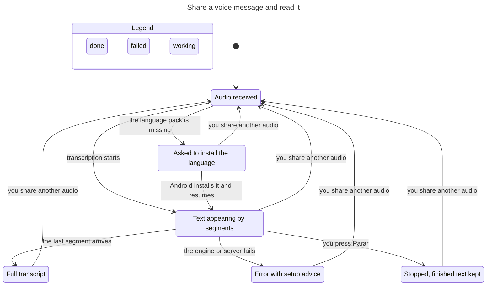

# Escriba verification

| Skill | What it checks | Tool |
| --- | --- | --- |
| [verify-escriba-sessions](../../.claude/skills/verify-escriba-sessions/SKILL.md) | The transcript shows only the audio shared last, even when a replaced engine still delivers text | TLA+ / TLC, 39 states |

The model passes on the current code. The generation ticket checked in every callback already prevents mixed transcripts. The check guards that design.

## Share a voice message and read it

Generated with pstack `/statechart` from [ShareAudio.tla](flows/share-audio/ShareAudio.tla) ([TLC report](flows/share-audio/report.md)).

